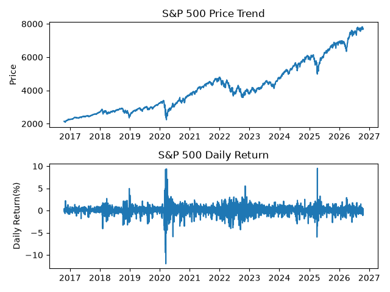

# SP500 Tracker

本来是出于对 pandas 的好奇，挑了一个刚好在看、也适合进行分析的 S&P 500 作为实战项目，尝试从真实数据入手学习数据处理。

但随着项目不断推进，它逐渐从一个 Pandas 练习项目，走向了 LLM 应用与金融市场分析的方向。

项目记录了一个 Python 初学者从 Pandas 基础操作开始，逐步学习 Matplotlib、API 请求、GitHub Actions 自动化运行，到自己寻找数据源、接入 LLM 的过程。

目前，项目已经实现自动获取市场数据和新闻，并调用大模型生成每日市场分析报告；未来希望继续向金融 Agent 方向发展。

## 目前实现

- 从 FRED 获取 S&P 500 指数、VIX、美国 10 年期国债收益率及 WTI 原油价格
- 对市场数据进行清洗、去重、排序和日期索引处理
- 将不同市场指标按日期横向合并，保留有意义的缺失值
- 计算 S&P 500 每日收益率，并将近期市场数据传入LLM生成报告
- 使用 Marketaux API 获取近期新闻，并提取所需字段
- 调用 DeepSeek API，结合市场数据与新闻生成中文市场分析报告
- 对网络请求设置超时、有限次数重试，并处理请求异常
- 通过 GitHub Actions 自动运行并归档每日分析报告
- 将报告保存至 reports/YYYY-MM-DD.txt

## 暂时移除的功能

- 使用 Matplotlib 绘制 S&P 500 价格与每日收益率图
- 通过 GitHub Actions 自动更新并提交 SP500.png
- CSV 历史数据的增量更新

以上功能曾在 V1.0–V1.2 中实现，计划在后续版本中重新整合。

## 接下来

- 整合v1.2功能，扩充可靠的市场数据来源，为 LLM 分析提供更多依据。
- 增加消息通知功能，将分析结果推送到个人设备。

## 运行结果

GitHub Actions 已成功运行，并生成按日期归档的市场分析报告。

报告目录：reports/

**历史运行结果（V1.2，当前 V1.3 不再自动更新此图）：**

## 更新日志

### V1.3
接入新闻API与LLM，结合市场数据和新闻，尝试分析 S&P 500 的波动原因。

- 新增`fetch_news()`、`generate_report()`、将`fetch_data()`修改为`fetch_fred_data()`。
- 添加`.env`管理本地API密钥，并通过 GitHub Secrets 向 Actions 注入所需密钥。
- 调整 GitHub Actions 工作流，使其定时生成每日市场分析报告，并按日期归档保存。
- 实际运行中发现 Marketaux 的异常日志可能暴露 API Token，修改日志输出，仅记录异常类型、HTTP 状态码和重试次数。
- 暂时移除 CSV 历史数据更新和绘图功能，为后续版本整合做准备。

### V1.2
尝试让项目进行自动化运行，选择了GitHub Actions作为自动化运行环境。

- 在网络请求连续失败时加入进程退出码，使 GitHub Actions 能正确识别程序运行失败。

- 添加了`requirements.txt`，记录项目所需要的python第三方依赖。

- 添加了`.github/workflows/update.yml`，用于配置 GitHub Actions 自动运行流程。

- 为了适配 Ubuntu 运行环境，暂时移除绘图中的中文字体设置，并将图表文字改为英文。

- 实际运行发现首次运行时，由于不存在 `sp500.csv`，程序跳过了 `merge_data()`，导致不同运行路径产生的数据结构不一致。将 `daily_return` 计算移动到最终数据确定后执行，保证首次运行和更新运行逻辑一致。

- 重构`merge_data()`，将旧数据作为可选参数，使首次运行与后续更新均经过统一的去重、排序流程。

- 添加了按照时间表触发的自动运行任务--每日 UTC 1：30（北京时间9：30）执行。

- 实现了 GitHub Actions 自动提交更新后的`SP500.png`。

### V1.1 
`daily_return`这一项的第一行因为没有前一天的数据，本来就是`NaN`。
但是旧代码直接使用了`dropna()`导致了程序每运行一次都会删掉一行历史数据...

也就是说程序看起来是在正常运行，但数据其实在偷偷变少(悲)。

- 在gpt老师的帮助下，学会了一套数据处理逻辑————先确定可信的基础数据，然后进行合并、去重、排序，最后再进行计算。
- 同时完成了函数拆分，将程序拆分为 `fetch_data()`、`clean_data()`、`merge_data()`、`paint()` 和 `main()`

### V1.0
完成第一个可运行版本：
- 从 FRED 获取 S&P 500 数据
- 保存本地 CSV
- 计算每日收益率
- 使用 Matplotlib 绘制价格与收益率图